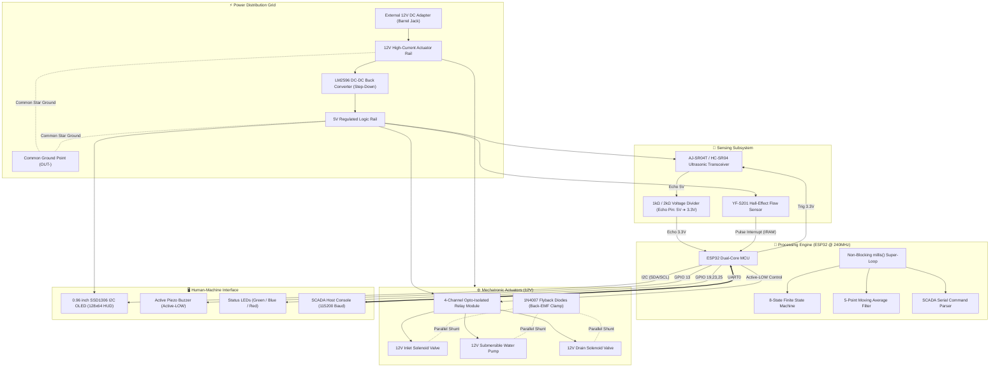
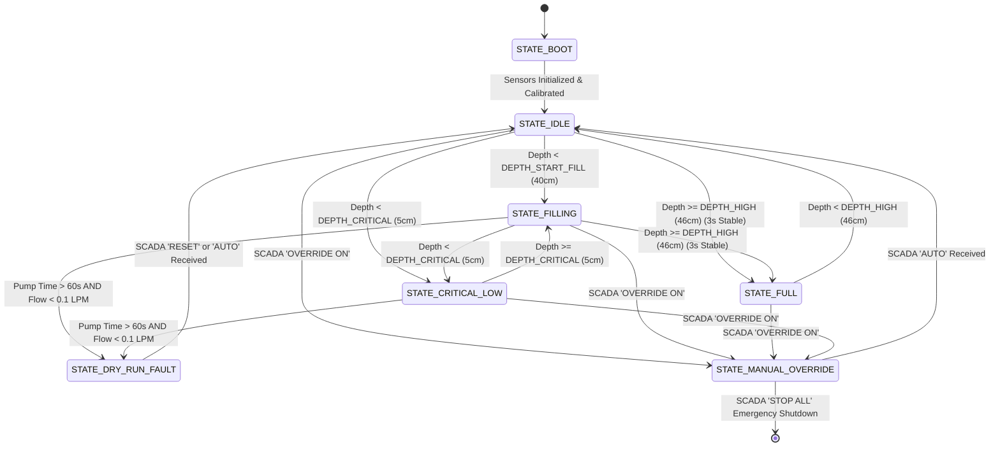

# 💧 AquaIntel Master OS — Automated Water Tank System

<div align="center">

```
   █████╗  ██████╗ ██╗   ██╗ █████╗ ██╗███╗   ██╗████████╗███████╗██╗     
  ██╔══██╗██╔═══██╗██║   ██║██╔══██╗██║████╗  ██║╚══██╔══╝██╔════╝██║     
  ███████║██║   ██║██║   ██║███████║██║██╔██╗ ██║   ██║   █████╗  ██║     
  ██╔══██║██║▄▄ ██║██║   ██║██╔══██║██║██║╚██╗██║   ██║   ██╔══╝  ██║     
  ██║  ██║╚██████╔╝╚██████╔╝██║  ██║██║██║ ╚████║   ██║   ███████╗███████╗
  ╚═╝  ╚═╝ ╚══▀▀═╝  ╚═════╝ ╚═╝  ╚═╝╚═╝╚═╝  ╚═══╝   ╚═╝   ╚══════╝╚══════╝
                     Autonomous Mechatronic Fluid Controller
```

[](https://www.espressif.com/)
[](file:///C:/Users/SANDANIMNE/Desktop/Ardino/robotic/AutomatedWaterTank/WATER_TANK-FULL.ino)
[](#-finite-state-machine-fsm-architecture)
[-informational?style=for-the-badge&logo=microgenetics&logoColor=white)](#-supervisory-control--telemetry-uiux)
[](#-industrial-safety-interlocks)
[](#-academic-coursework--credits)

<p align="center">
  <strong>An industrial-grade, event-driven automated fluid management system engineered to replace fragile mechanical float switches with deterministic embedded intelligence, digital signal filtering, active pump dry-run protection, and SCADA telemetry.</strong>
</p>

[Key Features](#-key-innovations--features) • [File Analysis](#-deep-file-by-file-analysis) • [Hardware Architecture](#-hardware-architecture--electrical-design) • [Pinout Matrix](#-pinout-matrix--hardware-interconnections) • [Firmware & Algorithms](#-firmware-architecture--algorithms) • [SCADA Interface](#-scada-serial-command-protocol) • [Calibration](#-tank-calibration--commissioning) • [Troubleshooting](#-diagnostics--troubleshooting-matrix)

</div>

---

## 📌 Executive Overview

Traditional fluid storage systems rely almost universally on **mechanical float switches**. While cheap and conceptually straightforward, mechanical switches suffer from fatal real-world failure modes:
1. **Mechanical Jamming & Calcification**: Mineral scale, bio-film, and suspended particulate deposits jam float linkages in open or closed states, causing catastrophic reservoir overflowing or unexpected system draining.
2. **Unmonitored Pump Cavitation & Burnout**: Submersible and centrifugal water pumps rely entirely on the pumped fluid for rotor cooling and bearing lubrication. If supply piping fails or runs dry, traditional systems keep the motor energized indefinitely, resulting in melted thermal seals, stator burnout, and potential electrical fire hazards.
3. **Zero Telemetry ("Black Box" Operation)**: Operators possess no insight into real-time water volume, consumption velocity ($L/\text{min}$), actuator health, or pipe clogging.

**AquaIntel Master OS** eliminates these vulnerabilities by replacing mechanical contacts with a **high-precision, non-contact waterproof ultrasonic transceiver** coupled to a **Hall-effect turbine flowmeter**. Governed by a custom **8-State Finite State Machine (FSM)** running on a 32-bit dual-core ESP32 microcontroller, the system provides autonomous closed-loop inlet and drain valve orchestration, acoustic jitter attenuation via rolling-window DSP, multi-stage pump dry-run interlocking, and real-time Heads-Up Display (HUD) telemetry.

---

## 🚀 Key Innovations & Features

| Capability | Engineering Implementation | Benefit / Impact |
| :--- | :--- | :--- |
| **Non-Contact Level Sensing** | Waterproof AJ-SR04T / HC-SR04 ultrasonic transducer with $10\,\mu\text{s}$ trigger logic | Immune to corrosion, mineralization, fouling, and liquid contamination. |
| **5-Point Moving Average DSP** | Rolling FIFO averaging buffer across 5 consecutive time-of-flight measurements | Filters fluid turbulence, wave crests, surface ripples, and acoustic anomalies. |
| **60-Second Dry-Run Interlock** | Dynamic flow validation: checks $Q < 0.1\,\text{L/min}$ over $60{,}000\,\text{ms}$ pump runtime | Instantly cuts motor power and latches safety lockouts before pump overheating occurs. |
| **Non-Blocking Architecture** | 100% `millis()` event-scheduled asynchronous tasks; zero `delay()` during cycles | System maintains 10 FPS OLED updates, continuous serial ingestion, and instantaneous ISR execution. |
| **Atomic Flow Integration** | `IRAM_ATTR` ISR on `FALLING` edge with critical section variable isolation | Zero pulse count corruption or multi-byte race conditions during 240 MHz core switching. |
| **Anti-Chatter Full Debounce** | Continuous $3{,}000\,\text{ms}$ stability requirement before confirming full status | Prevents relay fluttering, sparking, and contact erosion caused by surface water sloshing. |
| **Relay Boot Lockout** | `OUTPUT` driving `HIGH` prior to `pinMode()` register assignment | Fully eliminates common active-LOW relay momentary misfire and false cycling during ESP32 cold boot. |
| **SCADA Serial Command API** | Bidirectional ASCII protocol @ $115{,}200$ baud with manual override states | Complete remote supervisory monitoring, diagnostics, maintenance locking, and emergency stop. |
| **Heads-Up Display (HUD)** | 128×64 SSD1306 OLED featuring an animated liquid graphic bar & scrolling event log | On-site operator visibility into water level, LPM, valve positions, pump state, and error logs. |

---

## 📂 Deep File-by-File Analysis

Every file in this repository serves an essential function in the engineering lifecycle of the automated water tank system:

```
AutomatedWaterTank/
│
├── 📜 WATER_TANK-FULL.ino               # Production Firmware: AquaIntel Master OS v12.0
├── 📜 AquaIntel_Master_OS_v11.ino        # Reference Firmware: AquaIntel Master OS v11.1
├── 📑 NewRoboticReport(COHNDSE26.1F-004) .pdf # Academic Engineering Project Report & Schematics
└── 📘 README.md                         # Comprehensive System Documentation & Guide
```

### 1. [`WATER_TANK-FULL.ino`](file:///C:/Users/SANDANIMNE/Desktop/Ardino/robotic/AutomatedWaterTank/WATER_TANK-FULL.ino) — Production Firmware (AquaIntel OS v12.0)
* **Lines of Code**: 572 lines
* **Target Hardware**: ESP32 Dev Module (WROOM-32 / ESP32-30P)
* **Core Philosophy**: Compacted, hardened production release featuring streamlined branch prediction, memory optimization, and unified execution loops.
* **Key Mechanisms Implemented**:
  - `WRITE_PERI_REG(RTC_CNTL_BROWN_OUT_REG, 0)`: Disables the ESP32 hardware brownout detector during actuator inrush currents, preventing reboot loops when high-current solenoids trigger simultaneously.
  - Active-LOW relay pin latching: Pre-charges GPIO states before configuring output directions to guarantee silent, click-free power initialization.
  - Moving Average Filter with circular buffer (`FILTER_WINDOW = 5`) evaluating valid acoustic reflections between $2.0\,\text{cm}$ and $100.0\,\text{cm}$.
  - Non-blocking 6-task scheduler dividing loop intervals:
    - Ultrasonic Polling: Every $150\,\text{ms}$
    - Flow Integration: Every $1{,}000\,\text{ms}$
    - State Machine Evaluation: Every cycle ($0\,\text{ms}$)
    - Audio-Visual Feedback: Every cycle ($0\,\text{ms}$)
    - SCADA Serial Command Parser: Every cycle ($0\,\text{ms}$)
    - OLED Graphical Engine: Every $100\,\text{ms}$ ($10\,\text{FPS}$)
  - Dual-layer SCADA parser supporting live toggles between autonomous state transitions and manual terminal overrides.

### 2. [`AquaIntel_Master_OS_v11.ino`](file:///C:/Users/SANDANIMNE/Desktop/Ardino/robotic/AutomatedWaterTank/AquaIntel_Master_OS_v11.ino) — Development & Reference Firmware (v11.1)
* **Lines of Code**: 716 lines
* **Target Hardware**: ESP32 Dev Module
* **Purpose & Distinction**:
  - Contains extensive in-source engineering commentary, mechanical measurement guidelines, and calibration tutorials.
  - Documents exact physical measurement formulas for calculating `TANK_AIR_GAP` (sensor-face-to-floor) and mapping sensor dead zones.
  - Features expanded serial diagnostic banner reporting exact calibration limits upon bootup.
  - Retains throttle pulsing state markers (`DEPTH_THROTTLE`) for experimental progressive filling tests.

### 3. [`NewRoboticReport(COHNDSE26.1F-004) .pdf`](file:///C:/Users/SANDANIMNE/Desktop/Ardino/robotic/AutomatedWaterTank/NewRoboticReport(COHNDSE26.1F-004)%20.pdf) — Academic Project Report
* **Document Details**: 24-page formal engineering coursework dissertation.
* **Institution**: National Institute of Business Management (NIBM) — School of Computing & Engineering.
* **Program**: Higher Diploma in Software Engineering (Batch 26.1F).
* **Author / Registration**: K.G.L. Sandanimne (`COHNDSE26.1F – 004`).
* **Academic Supervisor**: Mr. Supun Asanga.
* **Key Topics Covered**:
  - Comparative analysis of level sensing: Submersible conductive probes vs. non-contact ultrasonic transducers (corrosion vs. acoustic propagation).
  - Component trade studies and justifications for ESP32 over 8-bit AVR platforms.
  - Transducer blind spot analysis: Overcoming the $25\,\text{cm}$ dead zone of the AJ-SR04T through tank height mathematics.
  - Complete 4-week engineering Gantt chart detailing unit testing, breadboard validation, firmware iteration, and endurance testing.
  - Cirkit Designer electrical schematic diagrams and star-grounding validation.

---

## 🏗 System Architecture & Electrical Design

The system couples low-voltage 3.3V digital logic with high-power 12V inductive mechatronics using a dual-rail power distribution topology and optoelectronic isolation.



### ⚡ Power Distribution & Electrical Protection

1. **Dual-Rail Voltage Separation**:
   - **12V High-Current Actuator Rail**: Directly powers the 12V submersible pump and inlet/outlet solenoids. Prevents motor electrical noise and switching transients from coupling into digital logic lines.
   - **5V Regulated Logic Rail**: Supplied via a calibrated **LM2596 buck converter**, energizing the relay coils (`JD-VCC`), the ultrasonic module, and the flow sensor.
2. **Optocoupler Isolation (`JD-VCC` Separation)**:
   - The jumper between `VCC` and `JD-VCC` on the 4-channel relay board is removed.
   - `JD-VCC` is powered exclusively from the 5V buck converter output to drive electromagnetic coils.
   - `VCC` is supplied with 3.3V logic levels from the ESP32 to power the internal optocoupler LEDs, establishing complete galvanic isolation between logic and inductive coils.
3. **Inductive Kickback Suppression (Flyback Diodes)**:
   - Solenoid valves and DC pump motors represent high-inductance coils. When switched off abruptly, the collapsing magnetic field creates high-voltage spikes ($V = -L \frac{di}{dt}$) that can destroy semiconductor junctions.
   - **1N4007 flyback diodes** are wired in reverse-parallel across each inductive load to clamp transient spikes safely.
4. **Echo Logic-Level Translation (Voltage Divider)**:
   - The ultrasonic module operates at 5V $V_{CC}$ and outputs a 5V TTL echo pulse. ESP32 GPIO pins are not 5V-tolerant (maximum rating: 3.6V).
   - A resistor divider network ($R_1 = 1\,\text{k}\Omega$, $R_2 = 2\,\text{k}\Omega$) scales the echo voltage:
     $$V_{\text{ESP32}} = V_{\text{ECHO}} \times \left(\frac{R_2}{R_1 + R_2}\right) = 5.0\,\text{V} \times \left(\frac{2000}{1000 + 2000}\right) = 3.33\,\text{V}$$
5. **Star Grounding Architecture**:
   - To eliminate ground bounce and parasitic noise caused by high motor currents, all ground references (ESP32 `GND`, sensor grounds, relay logic ground, and 12V power supply ground) converge in a single star topology at the `OUT-` terminal of the buck converter.

---

## 📋 Bill of Materials (BOM) & Specifications

| Component | Model / Part | Specifications | Role in System | Justification |
| :--- | :--- | :--- | :--- | :--- |
| **Microcontroller** | ESP32-WROOM-32 | 32-bit Dual-Core, 240 MHz, 520 KB SRAM, FreeRTOS | Master Automation Controller | Real-time ISR execution while rendering 10 FPS OLED graphics. |
| **Expansion Board** | ESP32 30-Pin Breakout | Screw terminal & DuPont pin breakout, onboard VCC/GND rails | Mechanical Wiring Backbone | Prevents loose breadboard jumper vibrations in active water pump environments. |
| **Level Sensor** | AJ-SR04T / HC-SR04 | Ultrasonic, 40 kHz, 20 cm – 450 cm range, IP67 waterproof probe | Non-contact water depth measurement | Complete immunity to scaling, rust, and water contact contamination. |
| **Flow Sensor** | YF-S201 | Hall-effect turbine, 1–30 L/min, 450 pulses/L, $5\text{V}$ operation | Flow rate verification & dry-run interlock | Provides deterministic feedback that water is actively moving through pipework. |
| **Relay Module** | 4-Channel Relay | Opto-isolated, 12V/5V JD-VCC, Active-LOW trigger, 10A/250VAC | Actuator Power Switching | Galvanically isolates 3.3V ESP32 outputs from high-current 12V solenoids and pump. |
| **Supply Inlet Valve** | 12V DC Solenoid | Normally Closed (NC), $0.02 - 0.8\,\text{MPa}$, $1/2''$ NPT | Automated reservoir water inlet | Shuts off supply immediately upon power loss or tank full condition. |
| **Drain Valve** | 12V DC Solenoid | Gravity drain / zero-pressure, Normally Closed (NC) | Automated fluid dispensing & dump | Automatic cutoff during low water levels to prevent reservoir total exhaustion. |
| **Water Pump** | 12V Submersible DC | 12V, $240\,\text{L/h}$, brushless centrifugal motor | Reservoir filling mechanism | High efficiency and compact footprint for automated pumping loops. |
| **Buck Converter** | LM2596 DC-DC | Step-Down, $3.0\text{V} - 40\text{V}$ input, 3A max output, adjustable | Logic Power Regulation | Steps down raw 12V supply to a rock-solid 5V rail for sensors and relay coils. |
| **Heads-Up Display** | SSD1306 OLED | 0.96 inch, 128×64 Monochrome, I2C interface ($0\text{x}3\text{C}$) | Local SCADA Telemetry & HUD | Displays tank fill bar, numeric depth, valve statuses, and scrolling event log. |
| **Acoustic Buzzer** | Active Piezo Buzzer | 5V Active-LOW, $85\,\text{dB} @ 10\,\text{cm}$, resonant frequency 2.3 kHz | Audible emergency & state alerts | Immediate operator notification for critical low levels, dry-run faults, and mode changes. |
| **Status LEDs** | 5mm Diffused LEDs | Green ($525\,\text{nm}$), Blue ($470\,\text{nm}$), Red ($625\,\text{nm}$) | Physical status indication | Instant visual distance indicators for Full (Green), Nominal (Blue), and Fault (Red). |

---

## 🔌 Pinout Matrix & Hardware Interconnections

```
                         ESP32 30-PIN MICROCONTROLLER
                                ┌──────────┐
                                │   EN  VP │
                     [IN_VLV] ◄─┤ D26   VN │
                     [PUMP]   ◄─┤ D27   D34│
                    [ECHO_DIV] ─►│ D18   D35│
                     [TRIG]   ◄─┤ D5    D32│
                     [OUT_VLV]◄─┤ D4    D33│
                     [SDA]    ◄─┤ D21   D25├──► [LED_RED]
                     [SCL]    ◄─┤ D22   D23├──► [LED_BLUE]
                     [LED_GRN]◄─┤ D19   D22├──► [OLED SCL]
                     [FLOW]   ─►│ D15   D21├──► [OLED SDA]
                     [BUZZER] ◄─┤ D13   GND├──► [COMMON STAR GND]
                                │ VIN   3V3├──► [RELAY VCC]
                                └──────────┘
```

### Pin Assignment Table

| ESP32 Pin | Connected Hardware | Signal / Direction | Logic Level | Circuit / Protection Detail |
| :---: | :---: | :---: | :---: | :---: |
| **GPIO 4** | Relay Channel 1 (OUT Valve) | Digital Output | Active-LOW | Controls gravity drain solenoid. Latched `HIGH` at boot. |
| **GPIO 16 / 26** | Relay Channel 2 (IN Valve) | Digital Output | Active-LOW | Controls supply inlet solenoid. Latched `HIGH` at boot. *(See PSRAM Note)* |
| **GPIO 17 / 27** | Relay Channel 3 (Pump) | Digital Output | Active-LOW | Controls 12V submersible pump relay. Latched `HIGH` at boot. *(See PSRAM Note)* |
| **GPIO 5** | AJ-SR04T / HC-SR04 Trigger | Digital Output | 3.3V High | Emits $10\,\mu\text{s}$ trigger pulse to begin ultrasonic measurement cycle. |
| **GPIO 18** | AJ-SR04T / HC-SR04 Echo | Digital Input | 3.3V (Scaled) | Connected via $1\,\text{k}\Omega / 2\,\text{k}\Omega$ voltage divider to protect GPIO from 5V. |
| **GPIO 15** | YF-S201 Flow Sensor | Digital Input (Interrupt) | 3.3V / 5V Pullup | Hardware ISR attached to `FALLING` edge. Pulse count tracks LPM. |
| **GPIO 13** | Active Piezo Buzzer | Digital Output | Active-LOW | Driven `LOW` to sound. Emits acoustic patterns for faults and state switches. |
| **GPIO 19** | Green LED | Digital Output | Active-HIGH | Current limited with $220\,\Omega$ resistor. Illuminates when tank is FULL. |
| **GPIO 23** | Blue LED | Digital Output | Active-HIGH | Current limited with $220\,\Omega$ resistor. Illuminates during NOMINAL / BOOT. |
| **GPIO 25** | Red LED | Digital Output | Active-HIGH | Current limited with $220\,\Omega$ resistor. Solid on LOW; flashes on FAULT. |
| **GPIO 21** | SSD1306 OLED Display (SDA) | I2C Data Line | 3.3V | Bidirectional serial data with internal/external $4.7\,\text{k}\Omega$ pullups. |
| **GPIO 22** | SSD1306 OLED Display (SCL) | I2C Clock Line | 3.3V | Synchronous serial clock running at standard $400\,\text{kHz}$ Fast Mode. |

> [!WARNING]
> **ESP32 PSRAM Hardware Notice**:
> In standard ESP32-WROOM-32 modules, **GPIO 16 and GPIO 17** operate reliably for general purpose I/O. However, in modules equipped with integrated external pseudo-static RAM (**ESP32-WROVER** or ESP32-D0WDQ6 with PSRAM enabled), GPIO 16 (CS) and GPIO 17 (CLK) are internally reserved by the flash/PSRAM controller. Driving them externally will corrupt memory and crash the FreeRTOS kernel. For WROVER boards, redirect actuators to **GPIO 26 and GPIO 27** as documented in the coursework report.

---

## ⚙️ Firmware Architecture & Algorithms

### 🔄 The Non-Blocking Asynchronous Super-Loop

Unlike novice Arduino sketches that rely on blocking `delay()` statements, AquaIntel Master OS utilizes an asynchronous cooperative multitasking architecture powered by `millis()`. Blocking delays freeze the CPU, causing missed flow pulses, unresponsive serial consoles, and stuttering displays.

```
       ┌────────────────────────────────────────────────────────┐
       │                   ESP32 void loop()                    │
       └───────────────────────────┬────────────────────────────┘
                                   │
              ┌────────────────────┼────────────────────┐
              ▼                    ▼                    ▼
     [Task 1: Every 150ms] [Task 2: Every 1000ms][Task 3: Every Cycle]
     Ultrasonic Ping & DSP   Atomic Flow Calc     Execute 8-State FSM
              │                    │                    │
              └────────────────────┼────────────────────┘
                                   │
              ┌────────────────────┼────────────────────┐
              ▼                    ▼                    ▼
     [Task 4: Every Cycle] [Task 5: Every Cycle] [Task 6: Every 100ms]
     LED & Buzzer Driver   SCADA Command Parser  Render OLED HUD (10FPS)
              │                    │                    │
              └────────────────────┴────────────────────┘
```

### 🧠 Finite State Machine (FSM) Architecture

The heart of the autonomous control logic is a deterministic 8-state machine:



#### State Definitions & Transition Criteria

| State | Index | Actuator Configuration | Audio-Visual Feedback | Entry / Exit Conditions |
| :--- | :---: | :--- | :--- | :--- |
| `STATE_BOOT` | 0 | All relays locked `OFF` | Blue LED Solid | Warm-up state upon power-on. Transitions to `STATE_IDLE` once first valid ultrasonic distance is acquired. |
| `STATE_IDLE` | 1 | Pump `OFF`, Inlet `CLS`, Drain governed by level | Blue LED Solid | Water level is nominal ($40.0\,\text{cm} \le \text{Depth} < 46.0\,\text{cm}$). Drain valve is allowed to open. |
| `STATE_FILLING` | 2 | Pump `ON` (100%), Inlet `OPN`, Drain `OPN` (if safe) | Blue LED Solid | Triggered when water level drops below `DEPTH_START_FILL` ($40.0\,\text{cm}$). Continuous replenishment until full. |
| `STATE_THROTTLING` | 3 | Pump modulated, Inlet `OPN` | Blue LED Solid | Soft-fill zone near tank capacity (`DEPTH_THROTTLE = 44.0 cm`) to prevent overshoot and pressure hammer. |
| `STATE_FULL` | 4 | Pump `OFF`, Inlet `CLS`, Drain `OPN` | Green LED Solid | Triggered when $\text{Depth} \ge 46.0\,\text{cm}$ continuously for $\ge 3{,}000\,\text{ms}$ (anti-slosh timer). |
| `STATE_CRITICAL_LOW` | 5 | Pump `ON`, Inlet `OPN`, **Drain `CLS` (LOCKED)** | Red LED Solid + Pulsing Buzzer | $\text{Depth} \le 5.0\,\text{cm}$. Drain valve is forcefully shut to prevent reservoir exhaustion and airlocks. |
| `STATE_DRY_RUN_FAULT` | 6 | **ALL ACTUATORS FORCED OFF (EMERGENCY)** | Red LED Flashing ($150\,\text{ms}$) | Safety Interlock: Pump enabled $> 60\,\text{s}$ with flow $< 0.1\,\text{L/min}$. Latching state; requires manual reset. |
| `STATE_MANUAL_OVERRIDE` | 7 | Controlled exclusively via serial commands | User controlled | Disengages FSM. Enables human operator maintenance and individual actuator testing. |

---

## 🧮 Mathematical Formulations & Signal Processing

### 1. Speed of Sound & Time-of-Flight Ranging
The ultrasonic transducer emits an ultrasound burst at $40\,\text{kHz}$ and monitors the elapsed time $\Delta t$ until the reflection returns:
$$d_{\text{raw}} = \frac{\Delta t \times v_{\text{sound}}}{2} = \frac{\Delta t \times 0.0343\,\text{cm}/\mu\text{s}}{2}$$

To translate this physical clearance into actual liquid depth, the formula accounts for the fixed vertical distance from the sensor face to the bottom of the reservoir (`TANK_AIR_GAP`):
$$\text{True Water Depth} = \text{TANK\_AIR\_GAP} - d_{\text{filtered}}$$

$$\text{Depth}_{\text{clamped}} = \max\left(0.0, \, \min\left(\text{True Water Depth}, \, \text{TANK\_AIR\_GAP}\right)\right)$$

### 2. 5-Point Moving Average Digital Low-Pass Filter
Water surface turbulence, bubbling from pump discharges, and acoustic reflections cause random spikes in raw echo readings. A rolling five-point moving average filter smooths high-frequency acoustic jitter:
$$\bar{d}_k = \frac{1}{N} \sum_{i=0}^{N-1} d_{k-i} \quad \text{where } N = 5$$

Implemented as an $O(1)$ ring buffer to avoid dynamic heap allocations:
```cpp
float applyMovingAverageFilter(float newReading) {
  sensorReadings[filterIndex] = newReading;
  filterIndex = (filterIndex + 1) % FILTER_WINDOW;
  
  float sum = 0.0;
  for (int i = 0; i < FILTER_WINDOW; i++) {
    sum += sensorReadings[i];
  }
  return sum / (float)FILTER_WINDOW;
}
```

### 3. Volumetric Flow Integration & Atomic Critical Sections
The YF-S201 Hall-effect turbine outputs a digital pulse train proportional to fluid velocity. With a manufacturer calibration coefficient of $450\,\text{pulses per liter}$:
$$Q \, (\text{L/min}) = \left(\frac{\Delta \text{pulses}}{\text{PULSES\_PER\_LITRE}}\right) \times \left(\frac{60\,\text{s}}{\Delta t_{\text{seconds}}}\right)$$

Because pulses arrive asynchronously via hardware interrupts at rates exceeding hundreds of Hertz, reading the 32-bit counter across a 32-bit memory bus can result in high-byte/low-byte tearing if interrupted mid-read. AquaIntel wraps this access in an atomic critical section:
```cpp
noInterrupts();
unsigned long pulses = pulseCount;
pulseCount = 0;
interrupts();

flowRate_LPM = ((float)pulses / PULSES_PER_LITRE) * 60.0;
```

---

## 🛡️ Industrial Safety Interlocks

### 1. Pump Dry-Run Burnout Protection
Water serves as the thermodynamic coolant and lubricant for submersible pump impellers. Running the motor dry causes rapid heat buildup, melting bearing assemblies and degrading waterproof seals within two minutes.

```
       Pump Enabled ──► Timer Start (millis)
                              │
                    Run Time > 60,000ms?
                              │
                    ┌─────────┴─────────┐
                   YES                  NO
                    │                   │
             Flow < 0.1 LPM?       Continue Normal
                    │              Monitoring Loop
            ┌───────┴───────┐
           YES              NO
            │               │
     [DRY-RUN FAULT]   Normal Flow
     - Cut Pump Power  Maintained
     - Close Solenoids
     - Flash RED LED
     - Latch Lockout
```

### 2. Water Ripple & Slosh Debounce ($3{,}000\,\text{ms}$)
As the water level approaches the full threshold ($46.0\,\text{cm}$), incoming pump discharge creates surface waves that cause instantaneous depth readings to cross above and below $46.0\,\text{cm}$ repeatedly. Without debounce logic, the relay would click on and off rapidly, causing severe contact arcing and relay premature failure. AquaIntel mandates that depth must exceed $46.0\,\text{cm}$ continuously for $3{,}000\,\text{ms}$ before authorizing a full-tank pump shutdown.

### 3. Critical Low Drain Cut-Off ($5.0\,\text{cm}$)
To preserve hydraulic prime and prevent downstream air entrainment, the gravity drain valve is forcefully locked shut whenever water depth drops below $5.0\,\text{cm}$, regardless of downstream demand.

---

## 🖥️ Supervisory Control & Telemetry (UI/UX)

### 📊 High-Density Heads-Up Display (HUD)

The system drives a 0.96-inch monochrome I2C SSD1306 OLED display ($128 \times 64$ resolution) divided into three high-contrast informational zones rendered at a steady 10 FPS:

```
┌─────────────────────────────────────────────────────────────┐
│ ┌────┐  ┌─────────────────────────────────────────────────┐ │
│ │████│  │ AUTO: FILLING                                   │ │ ◄── Zone 1: Status Bar
│ │████│  ├─────────────────────────────────────────────────┤ │
│ │████│  │ LVL: 42.5cm (TH)                                │ │ ◄── Zone 2: Telemetry Matrix
│ │░░░░│  │ VLV: IN[OPN] OUT[CLS]                           │ │     (Water Level, Valves,
│ │░░░░│  │ PMP:[ON ] FLW: 4.8 L/m                          │ │      Pump State & LPM)
│ │░░░░│  ├─────────────────────────────────────────────────┤ │
│ │░░░░│  │ > AUTO: PUMP START                              │ │ ◄── Zone 3: Event Log
│ │░░░░│  │ > SENSORS ONLINE                                │ │     (Two-Line Terminal)
│ └────┘  └─────────────────────────────────────────────────┘ │
│   ▲                                                         │
│   └─ Zone 0: Dynamic Graphic Liquid Level Bar (0-100%)       │
└─────────────────────────────────────────────────────────────┘
```

* **Zone 0 (Left Panel)**: 24×64 pixel dynamic reservoir rendering fill height mapped linearly to real water volume.
* **Zone 1 (Top Banner)**: Inverted-color banner announcing current operating state or critical warning alerts.
* **Zone 2 (Mid Matrix)**: Quantitative telemetry including current level, threshold markers (`(LO)`, `(TH)`, `(HI)`), individual valve statuses, pump operational state, and real-time LPM.
* **Zone 3 (Terminal)**: Two-line auto-scrolling FIFO system event log mirroring serial messages.

---

### 🔊 Audio-Visual Multi-Tone Feedback

| Event / State | Green LED | Blue LED | Red LED | Buzzer Acoustic Signature | Description |
| :--- | :---: | :---: | :---: | :---: | :--- |
| **System Boot** | `OFF` | `ON` | `OFF` | Silent | Sensor warm-up and relay pre-charge. |
| **Tank Full** | `ON` | `OFF` | `OFF` | Silent | Reservoir at maximum capacity ($\ge 46.0\,\text{cm}$). |
| **Nominal Level** | `OFF` | `ON` | `OFF` | Silent | Normal operating depth ($25.0\,\text{cm} - 45.9\,\text{cm}$). |
| **Low Warning** | `OFF` | `OFF` | `ON` | $500\,\text{ms}$ ON / $300\,\text{ms}$ OFF | Water dropped below safe threshold ($\le 25.0\,\text{cm}$). |
| **Pump Transition** | — | — | — | Dual Chirp ($60\,\text{ms}$ pulse $\times 2$) | Auditory feedback whenever pump starts or stops. |
| **Dry-Run Fault** | `OFF` | `OFF` | **Flashing** | Silent (Visual Emphasis) | High-frequency flashing indicating emergency pump shutdown. |

---

## 📡 SCADA Serial Command Protocol

AquaIntel includes a full bidirectional SCADA console running over UART0 at **$115{,}200$ baud** ($8\text{-N-}1$). Operators can monitor system logs, trigger emergency shutdowns, or engage manual overrides during maintenance.

### 🎮 Command Reference Table

| Serial Command | Mode Required | Action Taken by Controller | Response / Log Output |
| :--- | :---: | :--- | :--- |
| `AUTO` | Any | Restores full autonomous FSM control, clears faults, resumes normal cycling. | `> AUTO MODE RESTORED` |
| `OVERRIDE ON` | Any | Suspends automatic transitions; enables manual actuator commands; silences alarms. | `> MANUAL OVERRIDE ON` |
| `STOP ALL` | Any | **Emergency Stop**: Instantly de-energizes all relays (pump + valves) and halts cycles. | `> EMERGENCY STOP` |
| `RESET` | Any | Clears latching dry-run lockout flags and silences fault sirens. | `> FAULTS CLEARED` |
| `IN OPEN` | Override Only | Energizes supply inlet solenoid valve relay (opens valve). | `> IN VALVE OPENED` |
| `IN CLOSE` | Override Only | De-energizes supply inlet solenoid valve relay (closes valve). | `> IN VALVE CLOSED` |
| `OUT OPEN` | Override Only | Energizes gravity drain solenoid valve relay (opens valve). | `> OUT VALVE OPENED` |
| `OUT CLOSE` | Override Only | De-energizes gravity drain solenoid valve relay (closes valve). | `> OUT VALVE CLOSED` |
| `PUMP ON` | Override Only | Energizes water pump relay (starts water flow). | `> PUMP MANUAL ON` |
| `PUMP OFF` | Override Only | De-energizes water pump relay (stops water flow). | `> PUMP MANUAL OFF` |
| `ALARM ON` | Override Only | Forces active-LOW buzzer pin to audible state. | `> ALARM MANUAL ON` |
| `ALARM OFF` | Override Only | Silences active-LOW buzzer pin. | `> ALARM MANUAL OFF` |

<details>
<summary><strong>🔍 Click to expand: Sample SCADA Interactive Terminal Session</strong></summary>

```text
========================================
AquaIntel Master OS v12.0
Custom Tank Calibration (5cm-46cm)
========================================
[OK] Flow sensor ISR attached
[OK] OLED display initialized
> SYSTEM BOOTING
[READY] All systems operational. Entering main loop.

> SENSORS ONLINE
> AUTO: PUMP START
> AUTO: TANK FULL

OVERRIDE ON
> MANUAL OVERRIDE ON

OUT OPEN
> OUT VALVE OPENED

OUT CLOSE
> OUT VALVE CLOSED

PUMP ON
> PUMP MANUAL ON

STOP ALL
> EMERGENCY STOP

AUTO
> AUTO MODE RESTORED
```
</details>

---

## 📐 Tank Calibration & Commissioning

```
   ┌───────────────────────────────────┐ ◄── Top Tank Lip
   │   [AJ-SR04T Sensor Transceiver]   │
   ├───────────────────────────────────┤ ▲
   │  Blind Spot Zone (0 - 22 cm)      │ │
   ├ - - - - - - - - - - - - - - - - - ┤ │
   │                                   │ │ TANK_AIR_GAP (68.0 cm)
   │  Water Surface: FULL (46.0 cm)    │ │ (Sensor Face to Tank Bottom)
   │  ~~~~~~~~~~~~~~~~~~~~~~~~~~~~~~~  │ │
   │                                   │ │
   │  Water Surface: START FILL (40cm) │ │
   │  - - - - - - - - - - - - - - - -  │ │
   │                                   │ │
   │  Water Surface: LOW (25.0 cm)     │ │
   │  - - - - - - - - - - - - - - - -  │ │
   │                                   │ │
   │  Water Surface: CRITICAL (5.0 cm) │ │
   │  ═══════════════════════════════  │ ▼
   └───────────────────────────────────┘ ◄── Tank Floor (0.0 cm)
```

To configure AquaIntel for any tank geometry:

1. **Mount the Ultrasonic Transducer**:
   - Affix the sensor securely above the center of the tank, facing directly perpendicular to the water surface.
   - Ensure the maximum water level remains at least $25\,\text{cm}$ away from the sensor face to avoid the AJ-SR04T acoustic blind spot.
2. **Determine `TANK_AIR_GAP`**:
   - Measure the exact distance in centimeters from the **sensor face to the empty tank floor**.
   - Set `TANK_AIR_GAP` in line 38 of `WATER_TANK-FULL.ino` (default: `68.0`).
3. **Set `MAX_WATER_CAPACITY` & Thresholds**:
   - Define the physical maximum water depth desired when completely full (default: `46.0`).
   - Configure operational trigger levels:
     ```cpp
     const float TANK_AIR_GAP       = 68.0; // Distance from sensor face to tank floor
     const float MAX_WATER_CAPACITY = 46.0; // Water depth at 100% capacity
     const float DEPTH_CRITICAL     = 5.0;  // Emergency floor (drain locked)
     const float DEPTH_LOW          = 25.0; // Warning threshold (buzzer active)
     const float DEPTH_START_FILL   = 40.0; // Level that initiates pump cycle
     const float DEPTH_THROTTLE     = 44.0; // Transition to gentle filling
     const float DEPTH_HIGH         = 46.0; // Full tank cutoff point
     ```

---

## 🛠️ Installation & Getting Started

### Prerequisites

1. **Arduino IDE 2.x** or **VS Code + PlatformIO**.
2. **ESP32 Board Package**:
   - Open Arduino IDE ➔ Preferences ➔ Additional Boards Manager URLs.
   - Add: `https://raw.githubusercontent.com/espressif/arduino-esp32/gh-pages/package_esp32_index.json`
   - Open Tools ➔ Board Manager ➔ Search for `esp32` by Espressif ➔ Install **v2.0.14+**.
3. **Required Arduino Libraries**:
   - Install via Tools ➔ Manage Libraries:
     - `Adafruit SSD1306` (by Adafruit)
     - `Adafruit GFX Library` (by Adafruit)
     - `Wire` (Built-in)

### Flashing the Firmware

1. Connect the ESP32 to your workstation using a high-quality micro-USB data cable.
2. Open [`WATER_TANK-FULL.ino`](file:///C:/Users/SANDANIMNE/Desktop/Ardino/robotic/AutomatedWaterTank/WATER_TANK-FULL.ino) in the Arduino IDE.
3. Configure the **Tools** menu settings:
   - **Board**: `"ESP32 Dev Module"`
   - **Upload Speed**: `921600`
   - **CPU Frequency**: `240MHz (WiFi/BT)`
   - **Flash Frequency**: `80MHz`
   - **Flash Mode**: `QIO`
   - **Partition Scheme**: `Default 4MB with spiffs (1.2MB APP/1.5MB SPIFFS)`
   - **Core Debug Level**: `None`
   - **Port**: Select the active COM port (e.g., `COM3` on Windows).
4. Click **Upload** (`Ctrl + U`). If the upload fails to sync, hold down the `BOOT` button on the ESP32 until the flashing progress percentage begins.
5. Open the **Serial Monitor** (`Ctrl + Shift + M`) set to **$115{,}200$ baud** with `Newline` enabled.

---

## 🔍 Diagnostics & Troubleshooting Matrix

| Symptom / Fault | Root Cause | Solution & Verification |
| :--- | :--- | :--- |
| **ESP32 reboots continuously when pump/valves engage** | Inrush current causes supply voltage sag, triggering the hardware brownout reset. | 1. Ensure `WRITE_PERI_REG(RTC_CNTL_BROWN_OUT_REG, 0);` is active in `setup()`.<br>2. Add a $1000\,\mu\text{F}$ electrolytic capacitor across the 12V DC barrel jack.<br>3. Verify the external 12V power supply provides at least $3.0\,\text{A}$. |
| **Relays click/cycle once briefly during microcontroller boot** | ESP32 GPIO pins float or default to LOW during reset, briefly asserting active-LOW inputs. | AquaIntel initializes relay GPIO output states to `HIGH` prior to calling `pinMode(..., OUTPUT)`. Verify wiring matches assigned pins. |
| **OLED displays `[FAIL] OLED initialization failed!`** | I2C address conflict, missing pullup resistors, or swapped SDA/SCL lines. | 1. Verify SDA connects to **GPIO 21** and SCL connects to **GPIO 22**.<br>2. Confirm the display is powered with 5V or 3.3V.<br>3. Run an I2C scanner sketch to verify display responds at `0x3C` (or switch to `0x3D`). |
| **Ultrasonic reading displays `-1.0cm` or random erratic spikes** | 1. Target surface is within the $25\,\text{cm}$ blind spot.<br>2. Missing voltage divider on Echo pin.<br>3. Acoustic multipath reflections from narrow tank walls. | 1. Raise the sensor mount so maximum water never approaches closer than $25\,\text{cm}$.<br>2. Verify $1\,\text{k}\Omega / 2\,\text{k}\Omega$ divider network on GPIO 18.<br>3. Increase `FILTER_WINDOW` to 7 or 9 for stronger noise suppression. |
| **System triggers `FAULT: PUMP DRY RUN` when water is flowing** | 1. Flow sensor wired to incorrect pin.<br>2. Turbine jammed or backward fluid flow.<br>3. Interrupt edge misconfigured. | 1. Confirm flow signal wire connects to **GPIO 15**.<br>2. Ensure fluid flows in the direction of the arrow stamped on the YF-S201 housing.<br>3. Verify the sensor is supplied with 5V $V_{CC}$ and an internal/external pullup is present. |
| **ESP32 crashes or reboots into bootloader with PSRAM error** | Relay pins mapped to GPIO 16 or 17 on an ESP32 board with external PSRAM. | Reassign `IN_VALVE_PIN` to **GPIO 26** and `PUMP_PIN` to **GPIO 27** as detailed in the report. |

---

## 🔮 Future Roadmap & Enhancements

While AquaIntel Master OS delivers robust autonomous performance as a standalone controller, its ESP32 architecture supports rapid modernization without requiring hardware redesign:

- [ ] **Dual-Core FreeRTOS Task Pinning**: Dedicate Core 0 entirely to high-frequency sensor interrupts, moving average DSP, and state evaluations, while Core 1 manages display rendering, networking, and user interactions.
- [ ] **MQTT / Home Assistant Telemetry**: Publish real-time depth, consumption rate ($L/\text{min}$), and valve states over 2.4 GHz Wi-Fi to Home Assistant via lightweight JSON payloads.
- [ ] **Web-Based Responsive Dashboard**: Host an asynchronous WebSocket web server directly on the ESP32 SPIFFS filesystem for mobile browser controls without needing a dedicated app.
- [ ] **Predictive Leak & Anomaly Detection**: Analyze flow rate vs. water depth gradients to detect pipe burst anomalies, slow fixture leaks, or valve blockages.
- [ ] **Time-of-Use Machine Learning Optimization**: Log daily water usage profiles to schedule pump replenishment cycles during off-peak electricity tariff windows.

---

## 🎓 Academic Coursework & Credits

This project was developed and submitted as part of the formal robotics curriculum for the **Higher Diploma in Software Engineering (HDSE)**:

* **Institution**: National Institute of Business Management (NIBM) — School of Computing & Engineering
* **Batch**: HDSE 26.1F
* **Student Identifier**: `COHNDSE26.1F – 004`
* **Student Author**: **K.G.L. Sandanimne**
* **Project Supervisor**: **Mr. Supun Asanga**

### 📚 Literature References

1. **Adafruit Industries (2023)**. *Monochrome OLED Breakouts and SSD1306*. [Adafruit Learning System](https://learn.adafruit.com/monochrome-oled-breakouts).
2. **Barr, M. and Massa, A. (2006)**. *Programming Embedded Systems: With C and GNU Development Tools*, 2nd ed. O'Reilly Media. *(Finite State Machine patterns & non-blocking timing).*
3. **Components101 (2021)**. *YF-S201 Water Flow Sensor Datasheet & Pinout*. [Components101](https://components101.com/sensors/yf-s201-water-flow-sensor).
4. **Espressif Systems (2023)**. *ESP32 Series Datasheet & Technical Reference Manual*. [Espressif Systems](https://www.espressif.com/).
5. **Handson Technology (2020)**. *4-Channel 5V/12V Optical Isolated Relay Module User Guide*. [Handson Technology](https://handsontec.com).
6. **Smith, S. W. (1999)**. *The Scientist and Engineer's Guide to Digital Signal Processing*. California Technical Publishing. *(Moving average digital filter algorithms).*

---

<div align="center">

**Developed with precision for robust, fail-safe water automation.**  
If you find this project helpful for your engineering coursework or home automation setup, consider giving this repository a ⭐!

</div>
